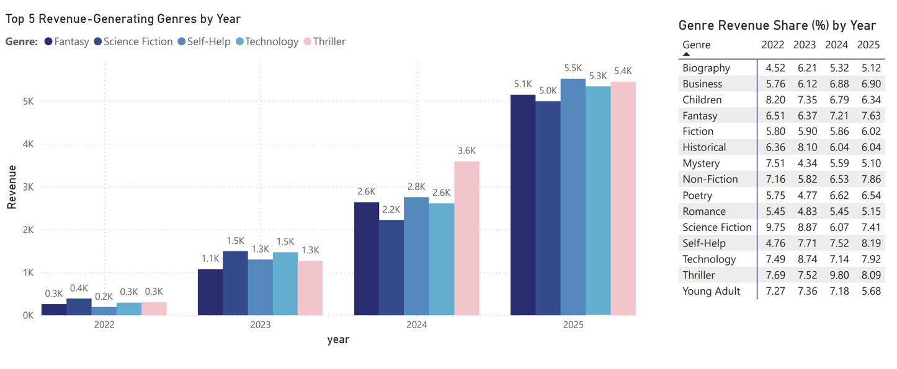
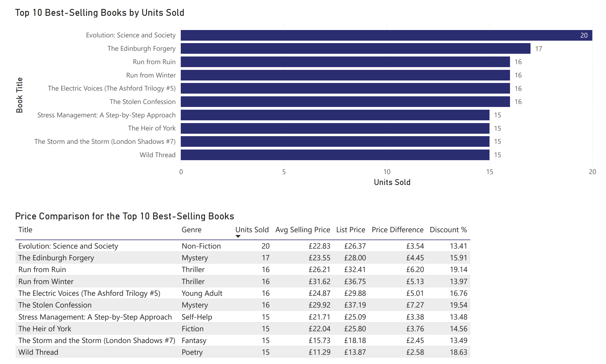
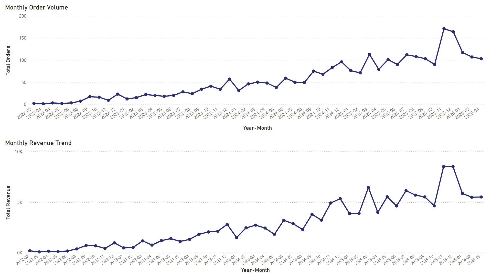
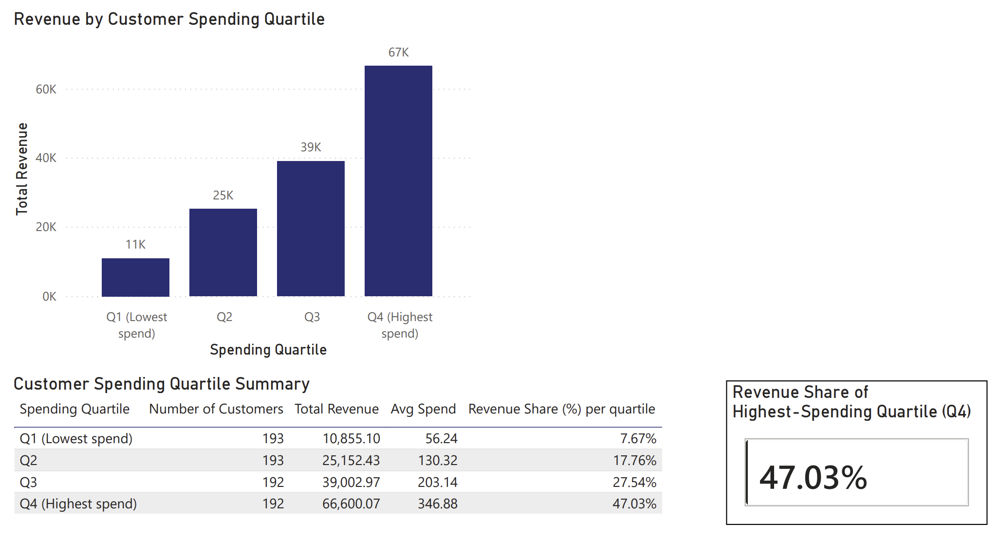
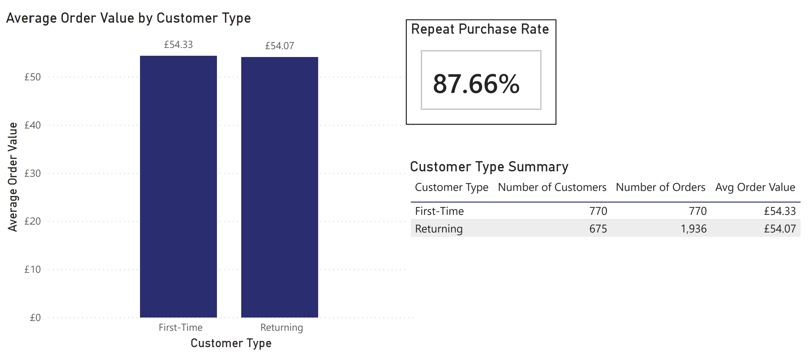
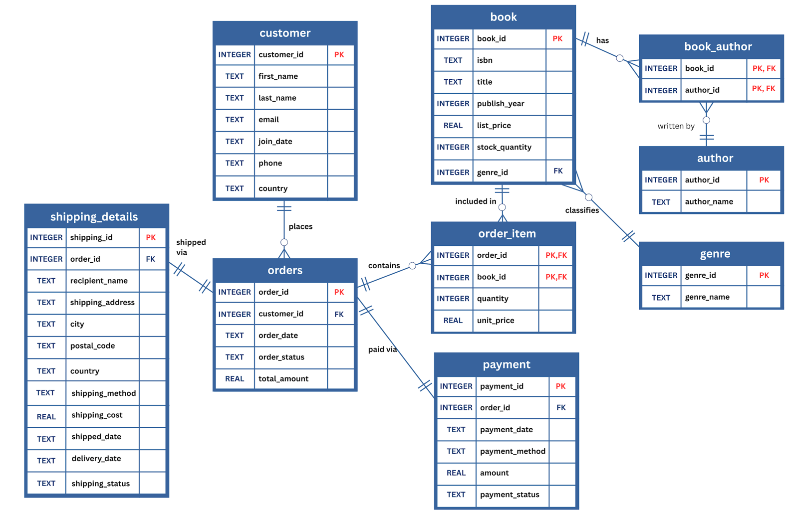

# 📚 Online Bookstore Database & Analytics

**Tools:** SQL (SQLite) · Python (pandas) · Power BI

This project covers the full path from a business scenario to business insight for a fictional UK online bookstore, **WBS**. We designed a 9-table relational database, normalised it to third normal form and built it in SQLite. We then filled it with realistic synthetic data, ran 30+ SQL checks to confirm the data could be trusted, and used it to answer five business questions in SQL and Power BI.

---

## 🎯 Business questions

1. Which genres contribute most to revenue, and how does that change over time?
2. Which books sell best, and how do their selling prices compare with list prices?
3. How do order volume and revenue vary by month and season?
4. How is customer lifetime spending distributed across spending quartiles?
5. How do repeat purchasing and average order value differ between first-time and returning customers?

## 💡 Key findings

| # | Finding | What WBS could do |
|---|---|---|
| 1 | Revenue is concentrated in a few genres, and the leader changes from year to year. **Self-Help** grew from 4.8% to 8.2% of revenue (2022 → 2025) and became the top genre in 2025. | Watch the high-performing genres closely for stock and promotions, and support declining ones with targeted campaigns or new titles. |
| 2 | Every top-10 bestseller sold below list price, with **discounts of 13–20%**. | Check that discounts actually bring enough extra volume to justify them. |
| 3 | Orders and revenue move together, and there is a clear Q4 peak. Monthly orders in Q4 averaged **71, about 29% above the overall average of 55**. | Plan buffer stock and delivery capacity for Q4, and use promotions to lift Q1. |
| 4 | The top spending quartile, about a quarter of customers, generated **47% of revenue (£66.6k)**. The bottom quartile generated only 7.7%. | Prioritise keeping high spenders with loyalty rewards and personalised offers. |
| 5 | **87.7% of customers made a repeat purchase**, but average order value was almost the same for new (£54.33) and returning (£54.07) customers. | Returning customers are valuable because they buy *more often*, not because they spend more per order. Focus on purchase frequency rather than basket size. |

> ⚠️ The data is synthetic. Some patterns, such as the Q4 peak and the discount range, were deliberately built into the generation rules, so these findings show the method rather than real market behaviour.

---

## 📊 Dashboards (Power BI)

**Genre revenue and yearly share**


**Top 10 best-selling books vs list price**


**Monthly order volume and revenue (Feb 2022 – Mar 2026)**


**Customer lifetime spending by quartile**


**Repeat purchase rate and average order value**


---

## 🗄️ Database design



The nine tables cover customers, the catalogue, transactions, payments and shipping:

| Relationship | Cardinality | How it's enforced |
|---|---|---|
| customer → orders | 1 : M | `orders.customer_id` → `customer.customer_id` |
| orders → order_item | 1 : M | `order_item.order_id` → `orders.order_id` |
| book → order_item | 1 : M | `order_item.book_id` → `book.book_id` |
| genre → book | 1 : M | `book.genre_id` → `genre.genre_id` |
| book ↔ author | M : N | resolved through the `book_author` junction table |
| orders → payment | 1 : 1 | `payment.order_id` (UNIQUE) |
| orders → shipping_details | 1 : 1 | `shipping_details.order_id` (UNIQUE) |

**Design decisions**
- **Normalised to 3NF.** For example, `genre_name` lives only in `genre` and `author_name` only in `author`, so each fact is stored once.
- **Composite primary keys** on `order_item (order_id, book_id)` and `book_author (book_id, author_id)`.
- **`unit_price` is stored separately from `list_price`.** The price a customer actually paid is preserved even if the catalogue price changes later.
- **Constraints enforce business rules.** UNIQUE applies to email and ISBN. CHECK constraints block negative stock, non-positive quantities, implausible prices and publication years. Status fields are limited to fixed values.
- **ISBN is stored as TEXT** so leading zeros are kept, and dates are stored as ISO text (`YYYY-MM-DD`).
- Each order is assumed to have **one shipment**, so split deliveries aren't modelled.

---

## 🧪 Synthetic data

The data was generated with a rule-based Python script (`python/generate_synthetic_data.py`):

| Table | Rows | | Table | Rows |
|---|---|---|---|---|
| customer | 800 | | orders | 3,000 |
| book | 1,200 | | order_item | 6,759 |
| author | 700 | | payment | 3,000 |
| genre | 15 | | shipping_details | 3,000 |

These business rules were built into the generator to make the data realistic:
- About **88% UK and 12% international** customers, with realistic email domains and UK phone and postcode formats
- Unique 13-digit ISBNs, list prices from £4.99 to £39.99, and plausible publication years
- Orders from **Feb 2022 to Mar 2026**, with growth over time and a **November–December peak**
- Selling price set at **70–100% of list price**, so nothing sells above list
- Payment and shipping outcomes that follow order status (e.g. returned → refunded) and customer location (UK vs international shipping methods)
- Logical date order: join date ≤ order date ≤ payment date ≤ shipped date ≤ delivery date

## ✅ Data validation

Before any analysis, the database had to pass every check in `sql/02_validation_checks.sql`:

| Category | Checks | Result |
|---|---|---|
| Referential integrity | No orphan records across all foreign keys | 0 violations |
| Duplicates | Unique emails, ISBNs, author names and composite keys | 0 duplicates |
| Date order | Order ≥ join, payment ≥ order, shipped ≥ payment, delivered ≥ shipped, no future orders | 0 violations |
| Financial consistency | Order total = item revenue + shipping; payment = order total; no item above list price | 0 mismatches |
| Status and shipping logic | Payment, shipping and order statuses agree; shipping method matches customer location | 0 violations |

---

## 📁 Repository structure

```
online-bookstore-sql/
├── README.md
├── sql/
│   ├── 01_schema.sql              # CREATE TABLE statements, keys and constraints
│   ├── 02_validation_checks.sql   # 30+ data quality checks (all should return 0 rows)
│   └── 03_business_insights.sql   # 5 analysis queries (CTEs, NTILE, ROW_NUMBER, SUM OVER)
├── python/
│   ├── generate_synthetic_data.py # builds all 9 tables → bookstore_synth_final.xlsx
│   └── load_to_sqlite.py          # loads the workbook into wbs_bookstore.db
└── images/                        # ER diagram and Power BI dashboard screenshots
```

## ▶️ How to run

```bash
pip install pandas openpyxl

# 1. Generate the synthetic data (writes bookstore_synth_final.xlsx)
python python/generate_synthetic_data.py

# 2. Create the SQLite database and load the data (writes wbs_bookstore.db)
python python/load_to_sqlite.py

# 3. Run the validation checks and analysis queries
sqlite3 wbs_bookstore.db < sql/02_validation_checks.sql
sqlite3 wbs_bookstore.db < sql/03_business_insights.sql
```

You can also open `wbs_bookstore.db` in [DB Browser for SQLite](https://sqlitebrowser.org/) and run the queries there.

> The generator uses today's date as the end of the order window, so a fresh run gives slightly different numbers from those shown above.

## 🧠 SQL techniques used

Multi-table joins · CTEs · window functions (`NTILE`, `ROW_NUMBER`, `SUM() OVER`) · date functions (`strftime`) · conditional aggregation · anti-joins for orphan detection

## ⚠️ Limitations

- The data is synthetic and can't fully reflect real customer behaviour. Real data wasn't used because of privacy and UK GDPR.
- The revenue analysis doesn't include stock-outs, lead times or profit margins.
- Average order value uses `total_amount`, which includes shipping, while the other revenue figures use book sales only.

## 🔭 Next steps

- Build a book recommendation feature from customers' purchase history
- Add cost and margin data so profitability can be analysed, not just revenue

---
